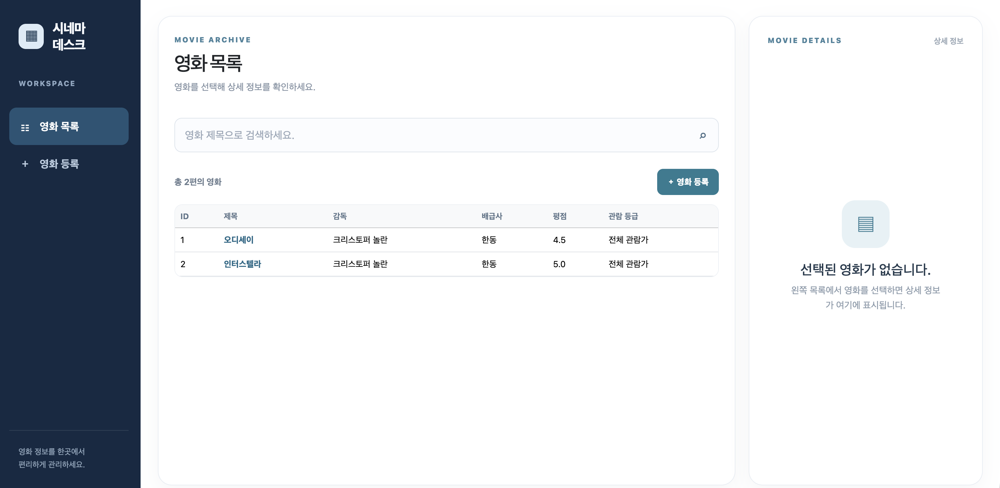
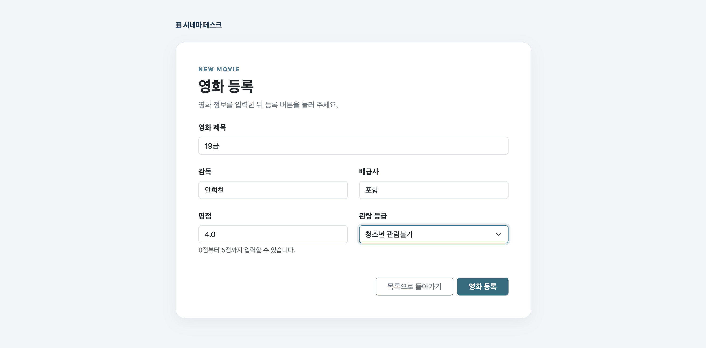

# 시네마 데스크: 영화 관리 Web UI

Spring Boot와 Thymeleaf로 만든 영화 등록·목록 조회 웹 서비스다. 영화의 제목, 감독, 배급사, 평점, 관람 등급을 관리한다. 데이터베이스 대신 `LinkedHashMap<Long, Movie>`에 데이터를 저장하므로 서버를 다시 시작하면 등록한 데이터가 사라진다.

- **Render 배포 URL:** 배포 후 추가 예정
- **기술:** Java 17, Gradle, Spring Boot, Thymeleaf, Bootstrap 5

## 실행 방법

Java 17 이상이 설치된 환경에서 다음 명령을 실행한다.

```bash
./gradlew bootRun
```

브라우저에서 `http://localhost:8080/movies`에 접속한다.

## 프로젝트 구조

```text
src/main/java/org/example/sb_webui_crud/
├── controller/
│   ├── MovieWebController.java    # HTML 화면과 Form 요청
│   └── MovieController.java       # JSON REST API
├── service/MovieService.java      # 검증 및 비즈니스 로직
├── repository/
│   ├── MovieRepository.java       # 저장소 인터페이스
│   └── MemoryMovieRepository.java # LinkedHashMap 메모리 저장소
├── domain/Movie.java              # 영화 데이터
└── dto/
    ├── MovieRequest.java
    └── MovieResponse.java

src/main/resources/templates/movies/
├── list.html                      # 영화 목록
└── form.html                      # 영화 등록 Form
```

`MovieWebController`와 `MovieController`는 같은 `MovieService`를 사용한다. 브라우저용 `/movies` 경로는 HTML 화면을 반환하고, `/api/movies` 경로는 JSON을 반환한다.

## 주요 화면

등록 전 영화 목록:



영화 등록 Form:



등록 후 영화 목록:


## Web Endpoint

| HTTP Method | URL | 기능 |
| --- | --- | --- |
| GET | `/movies` | 전체 영화 목록 표시 |
| GET | `/movies?q=제목` | 제목으로 검색한 목록 표시 |
| GET | `/movies?selected=ID` | 선택한 영화의 상세 정보 표시 |
| GET | `/movies/new` | 영화 등록 Form 표시 |
| POST | `/movies` | Form 데이터 등록 후 `/movies`로 이동 |

기존 REST API는 `/api/movies`에서 JSON으로 영화 조회·검색·등록·수정·삭제를 제공한다.

## 이번 과제 키워드

- `@Controller`: 브라우저 요청을 처리하고 Thymeleaf View 이름을 반환한다.
- `Model`: Controller가 화면에 표시할 데이터를 View로 전달한다.
- Thymeleaf: `th:each`, `th:text`, `th:href` 등을 사용해 서버 데이터를 HTML에 반영한다.
- HTML Form과 `@ModelAttribute`: Form의 `name`에 맞는 값을 DTO 객체로 받는다.
- `redirect:`와 PRG Pattern: 등록 요청(POST) 후 목록을 다시 요청(GET)하게 한다.
- Bootstrap 5: 목록과 등록 Form의 반응형 UI를 구성한다.
- Layered Architecture: Controller → Service → Repository로 역할을 나눈다.

## 핵심 내용 정리

1. 이 프로젝트에서 `@RestController`는 영화 데이터를 JSON으로 반환하고, `@Controller`는 Thymeleaf HTML View를 반환한다. 두 Controller는 같은 Service를 사용한다.
2. Controller가 `Model`에 `movies`를 담으면 Thymeleaf의 `th:each`가 목록을 반복하고 `th:text`가 각 값을 출력한다.
3. 등록 Form의 `name="title"`처럼 입력 요소의 `name`이 `MovieRequest`의 필드명과 일치해야 `@ModelAttribute`가 값을 연결할 수 있다.
4. 등록 후 `redirect:/movies`를 반환하면 브라우저가 목록을 GET으로 다시 요청한다. 따라서 목록 화면을 새로고침해도 같은 등록 요청이 반복되지 않는다.
5. 저장소를 `LinkedHashMap<Long, Movie>`로 바꿔 영화의 ID를 키로 저장하고 조회한다.

## Weekly Report

### Key Learning

- Controller가 `Model`에 데이터를 담고 Thymeleaf가 그 데이터를 HTML로 출력하는 흐름을 알게 되었다.
- `@ModelAttribute`가 Form의 `name`과 DTO 필드명을 연결해 입력값을 받는다는 점을 알게 되었다.
- POST 후 Redirect → GET으로 이어지는 PRG 흐름을 배웠다.

### Web UI Flow

`Browser → MovieWebController → MovieService → MovieRepository → MemoryMovieRepository → Model → Thymeleaf → HTML`

브라우저의 목록 요청을 Controller가 받아 Service와 Repository에서 영화를 조회한다. 조회 결과를 `Model`에 담으면 Thymeleaf가 HTML 목록을 생성한다.

### Form Flow

`HTML Form → MovieWebController → MovieService → MovieRepository → MemoryMovieRepository → redirect:/movies → GET /movies`

Form을 제출하면 Controller가 입력값을 `MovieRequest`로 받고 Service를 통해 저장한다. 이후 목록으로 리다이렉트하여 브라우저가 GET 요청을 보낸다.

### Problem & Solution

처음 Controller와 UI를 연결할 때 새로운 어노테이션을 적절히 적용하기 어려웠다. AI와 함께 `@Controller`, `Model`, `@ModelAttribute`의 역할을 공부한 뒤 작성했던 코드를 지우고 가능한 한 도움 없이 다시 작성했다. 그 과정에서 요청 URL, Form 입력값, DTO 필드가 어떻게 이어지는지 익혔다.

### Code Review

가장 중요하다고 생각한 코드는 `MovieWebController.saveMovie()`다.

```java
@PostMapping
public String saveMovie(@ModelAttribute MovieRequest movieRequest) {
    movieService.create(movieRequest);
    return "redirect:/movies";
}
```

이 메서드는 Form의 입력값을 `MovieRequest`로 받아 Service에 전달한다. 저장 후 목록으로 리다이렉트하므로 등록과 목록 조회가 POST → Redirect → GET 순서로 이어진다. Form의 `name`과 DTO 필드명이 맞아야 값이 올바르게 전달된다는 점도 중요하다.

### AI Usage

- AI의 도움으로 `form.html`과 `list.html`의 Bootstrap UI를 만들었다. URL, Form의 `method`와 `th:action`, 입력 필드의 `name`, Model 변수명과 Thymeleaf 문법을 확인했다.
- 어노테이션별 예시 코드를 보고 역할을 공부한 뒤 Java Controller를 다시 작성했다.
- 저장소를 ArrayList에서 Map 구조로 변경할 때 Map 문법에 관한 도움을 받았다.
- readme를 작성할 때 마크다운 형식의 토대와 편집에 도움을 받았고, 내용은 직접 작성하였다.

### Reflection

REST API와 Web UI가 서로 다른 Controller를 사용해도 Service를 공유할 수 있다는 점을 이해했다. 화면을 만드는 역할과 데이터를 처리하는 역할을 나누어 생각하는 데 도움이 되었다.
